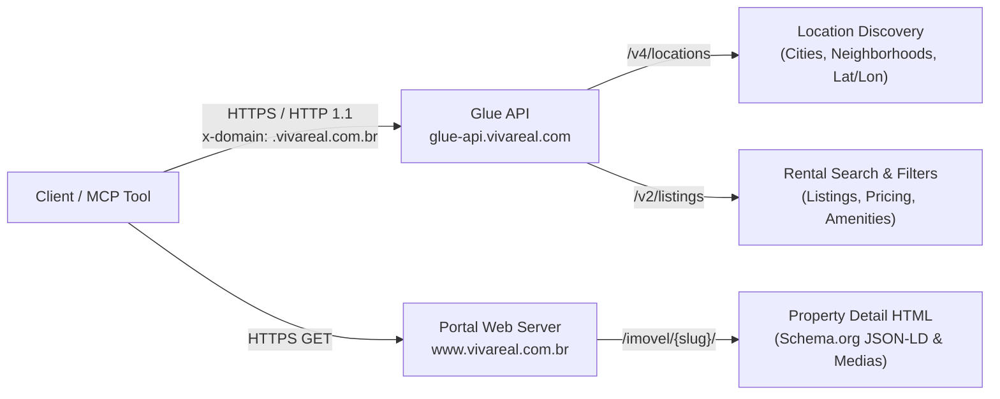

# Reverse-Engineered API Specification: Viva Real (Grupo OLX)

## 1. Overview & Architecture

**Viva Real** (`https://www.vivareal.com.br`) is one of Brazil's largest real estate marketplaces, owned by **Grupo OLX** (formerly ZAP Group / OLX Brasil).

The public web experience is powered by **Next.js** (App Router with Server-Side Rendering and streaming React Server Components). All real estate search queries, aggregations, location suggestions, and listing details are served by the centralized backend API: **Glue API** (`https://glue-api.vivareal.com`).



### 1.1 Authentication & Security Requirements

- **Authentication**: **None required**. Rental listings, search filters, pagination, location autocomplete, and property details are publicly accessible without authentication, user logins, session tokens, or API keys.
- **Mandatory Request Headers**:
  - `x-domain`: **`.vivareal.com.br`** (Note: the **leading dot** is strictly required by the Glue API routing engine; requests with `www.vivareal.com.br` or missing the dot receive unexpected responses or 500 errors).
  - `User-Agent`: Standard modern browser user agent (e.g. `Mozilla/5.0 (X11; Linux x86_64) AppleWebKit/537.36 (KHTML, like Gecko) Chrome/120.0.0.0 Safari/537.36`).
  - `Accept`: `application/json, text/plain, */*`.
- **HTTP Protocol & Transport**: Standard Python HTTP client libraries (such as `httpx`) must disable HTTP/2 (`http2=False` / force HTTP/1.1) to prevent triggering Cloudflare automated TLS fingerprint challenges on the Glue API domain.

---

## 2. API Endpoints Specification

### 2.1 Rental Search Endpoint (`/v2/listings`)

The primary search endpoint serving property listings matching geographical and physical filter constraints.

```http
GET /v2/listings?{query_parameters} HTTP/1.1
Host: glue-api.vivareal.com
x-domain: .vivareal.com.br
User-Agent: Mozilla/5.0 ...
```

#### Query Parameters

| Parameter | Type | Required | Example | Description |
| :--- | :--- | :--- | :--- | :--- |
| `portal` | `string` | **Yes** | `VIVAREAL` | Portal identifier for Grupo OLX backend routing. |
| `categoryPage` | `string` | **Yes** | `RESULT` | Page category context (`RESULT`). |
| `business` | `string` | **Yes** | `RENTAL` | Business transaction type (`RENTAL` or `SALE`). |
| `addressLocationId` | `string` | Recommended | `BR>Minas Gerais>NULL>Timoteo` | Exact location hierarchy identifier obtained from location discovery. |
| `addressCity` | `string` | Optional | `Timóteo` | Municipality name. |
| `addressState` | `string` | Optional | `Minas Gerais` | State name. |
| `addressType` | `string` | Optional | `city`, `neighborhood` | Category type of the specified location. |
| `addressPointLat` | `float` | Optional | `-19.582378` | Latitude center coordinate. |
| `addressPointLon` | `float` | Optional | `-42.644959` | Longitude center coordinate. |
| `bedrooms` | `string` | Optional | `2,3,4` | Comma-separated list of acceptable bedroom counts. *(Note: Do NOT repeat the parameter; comma-separated format is mandatory)*. |
| `bathrooms` | `string` | Optional | `1,2` | Comma-separated bathroom counts. |
| `parkingSpaces` | `string` | Optional | `1,2` | Comma-separated garage/parking spaces counts. |
| `priceMin` | `integer` | Optional | `1000` | Minimum base rent in BRL. |
| `priceMax` | `integer` | Optional | `3000` | Maximum base rent in BRL. |
| `priceMinCondo` | `integer` | Optional | `100` | Minimum monthly condominium fee. |
| `priceMaxCondo` | `integer` | Optional | `500` | Maximum monthly condominium fee. |
| `rentalTotalPriceMin` | `integer` | Optional | `1500` | Minimum total monthly rental package (Rent + Condo). |
| `rentalTotalPriceMax` | `integer` | Optional | `3500` | Maximum total monthly rental package (Rent + Condo). |
| `rentTotalPrice` | `boolean` | Optional | `true` | Must be `true` when filtering by total monthly rental package. |
| `usableAreasMin` | `integer` | Optional | `50` | Minimum usable floor area in m². |
| `usableAreasMax` | `integer` | Optional | `250` | Maximum usable floor area in m². |
| `unitTypes` | `string` | Optional | `APARTMENT` | Primary property classification code. |
| `unitTypesV3` | `string` | Optional | `APARTMENT` | V3 taxonomy classification code. |
| `usageTypes` | `string` | Optional | `RESIDENTIAL` | Property usage classification (`RESIDENTIAL` or `COMMERCIAL`). |
| `unitSubTypes` | `string` | Optional | `UnitSubType_NONE,DUPLEX...` | Comma-separated allowed unit subtypes. |
| `sort` | `string` | Optional | `MOST_RELEVANT` | Listing ordering criteria (see Section 3.2). |
| `size` | `integer` | Optional | `30` | Number of listings per page (Max: **30**; requests > 30 return HTTP 400). |
| `from` | `integer` | Optional | `0` | Zero-based listing offset index (`size * (page - 1)`). |
| `page` | `integer` | Optional | `1` | 1-indexed page number indicator. |
| `includeFields` | `string` | Optional | `search,page` | Field selection filter for payload optimization. |

---

### 2.2 Location Discovery & Autocomplete Endpoint (`/v4/locations`)

Resolves arbitrary location search queries (cities, neighborhoods, streets) into canonical location IDs and coordinates.

```http
GET /v4/locations?portal=VIVAREAL&q=Tim%C3%B3teo&size=10&listingType=USED&businessType=RENTAL&fields=neighborhood,city,street,zone&includeFields=address.neighborhood,address.city,address.state,address.zone,address.locationId,address.point HTTP/1.1
Host: glue-api.vivareal.com
x-domain: .vivareal.com.br
User-Agent: Mozilla/5.0 ...
```

#### Response Structure
```json
{
  "result": [
    {
      "category": "city",
      "address": {
        "city": "Timóteo",
        "zone": "",
        "locationId": "BR>Minas Gerais>NULL>Timoteo",
        "state": "Minas Gerais",
        "neighborhood": "",
        "point": {
          "lat": -19.582378,
          "lon": -42.644959,
          "source": "GeoPointSource_NONE"
        }
      }
    }
  ]
}
```

---

### 2.3 Property Detail Retrieval

Viva Real offers two complementary mechanisms for property detail retrieval:

#### Mechanism A: Embedded Search Payload (Zero Additional Network Requests)
Every listing returned by `/v2/listings` or `/v4/listings` already contains the comprehensive listing entity:
- `listing.id`: Unique internal listing identifier (e.g. `"2900513774"`).
- `listing.externalId`: Agency / broker reference code (e.g. `"0d017d"`).
- `listing.pricingInfos`: Array containing monthly rent, condo fee, IPTU, and total rental price.
- `listing.address`: Street name, number, neighborhood, municipality, zip code, and exact geospatial coordinates.
- `listing.usableAreas`: Usable area array in m².
- `listing.bedrooms`, `listing.bathrooms`, `listing.suites`, `listing.parkingSpaces`: Room counts.
- `listing.amenities`: Complete array of amenity tags.
- `medias`: Array of property photos and floor plans.
- `account`: Broker / agency name, logo, contact phones, and WhatsApp numbers.
- `link.href`: Canonical website navigation path.

#### Mechanism B: Public Listing Page (`/imovel/{slug}/`)
For direct URL lookups, the web detail page serves structured microdata:

```http
GET /imovel/casa-4-quartos-alphaville-bairros-timoteo-com-garagem-211m2-aluguel-RS2800-id-2900513774/ HTTP/1.1
Host: www.vivareal.com.br
User-Agent: Mozilla/5.0 ...
Accept: text/html,application/xhtml+xml
```

The page embeds a `Schema.org` `Product` JSON-LD block:
```json
{
  "@context": "https://schema.org",
  "@type": "Product",
  "name": "Imóvel em Alphaville, Timóteo - MG",
  "description": "Casa com quatro quartos, sendo duas suites...",
  "sku": "2900513774",
  "image": [
    "https://resizedimgs.vivareal.com/img/vr-listing/3aa200c10c6b666e3f7f3b02c4f5b764/casa-com-4-quartos-para-alugar-211m-no-alphaville-timoteo.webp?action=fit-in&dimension=614x297"
  ],
  "offers": {
    "@type": "Offer",
    "url": "https://www.vivareal.com.br/imovel/.../",
    "priceCurrency": "BRL",
    "price": 2800,
    "availability": "https://schema.org/InStock"
  }
}
```

The live detail HTML also serializes the full listing in the Next.js Flight stream (`self.__next_f.push(...)`) at `baseData.pageData.listing`. Its explicit `address`, `prices.rental`, `amenities`, and `advertiser` fields supply detail values omitted from Product JSON-LD. The parser leaves absent feature and fee values unknown rather than inventing a Timóteo address or treating rent alone as the monthly total.

---

## 3. Filter Conventions & Parameter Encoding

### 3.1 Room Filtering (`bedrooms`, `bathrooms`, `parkingSpaces`)
- **Format**: Comma-separated integer list without spaces.
- **Example**: `bedrooms=2,3,4` matches properties that have 2, 3, or 4 bedrooms.
- **Failure Mode**: Passing repeated keys (`bedrooms=2&bedrooms=3`) triggers an HTTP 400 Bad Request error from the Glue API parser.

### 3.2 Sorting Options (`sort`)
The Glue API supports five discrete sorting criteria:

| Sort Value | Website UI Label | Ordering Mechanism |
| :--- | :--- | :--- |
| `MOST_RELEVANT` | *Mais relevantes* | Default algorithmic ranking based on listing quality and relevance. |
| `MOST_RECENT` | *Mais recente* | Chronological publication date descending. |
| `LOWEST_PRICE` | *Menor preço* | Base monthly rent ascending. |
| `BIGGEST_PRICE` | *Maior preço* | Base monthly rent descending. |
| `BIGGEST_AREA` | *Maior área* | Usable area in m² descending. |

### 3.3 Property Type Filtering (4-Tuple Taxonomy)
Filtering by property category in the Glue API requires passing a coordinated 4-tuple of query parameters:

| Property Type | `unitTypes` | `unitTypesV3` | `usageTypes` | `unitSubTypes` |
| :--- | :--- | :--- | :--- | :--- |
| **Apartment** | `APARTMENT` | `APARTMENT` | `RESIDENTIAL` | `UnitSubType_NONE,DUPLEX,LOFT,STUDIO,TRIPLEX` |
| **Home** | `HOME` | `HOME` | `RESIDENTIAL` | `UnitSubType_NONE,SINGLE_STOREY_HOUSE,VILLAGE_HOUSE,KITNET` |
| **Condo Home**| `HOME` | `CONDOMINIUM` | `RESIDENTIAL` | `CONDOMINIUM` |
| **Penthouse**  | `APARTMENT` | `PENTHOUSE` | `RESIDENTIAL` | `PENTHOUSE` |
| **Flat**       | `APARTMENT` | `FLAT` | `RESIDENTIAL` | `FLAT` |
| **Kitnet**     | `APARTMENT` | `KITNET` | `RESIDENTIAL` | `KITNET` |
| **Land/Lot**   | `ALLOTMENT_LAND` | `RESIDENTIAL_ALLOTMENT_LAND` | `RESIDENTIAL` | `UnitSubType_NONE,CONDOMINIUM,VILLAGE_HOUSE` |
| **Commercial** | `HOME` | `COMMERCIAL_PROPERTY` | `COMMERCIAL` | `UnitSubType_NONE` |
| **Office**     | `OFFICE` | `OFFICE` | `COMMERCIAL` | `UnitSubType_NONE,OFFICE,FLOOR` |

---

## 4. Pagination Behavior & Boundary Conditions

### 4.1 Page Size Limits
- **Maximum Page Size**: **30 items per request**.
- **Enforcement**: Requesting `size > 30` (e.g. `size=36`) returns HTTP 400 Bad Request with:
  ```json
  {"err": "{ code: 'UNEXPECTED-RESPONSE', statusCode: 400, details: { message: 'Size is above acceptable limit' } }"}
  ```
- **Offset Calculation**: Zero-based offset parameter `from = size * (page - 1)`.

### 4.2 Boundary & Out-of-Bounds Behavior
- **Past Result Set (within index depth)**: When `from` exceeds the available count (e.g. requesting page 10 when only 2 items exist), the Glue API returns HTTP 200 with an empty collection:
  `{"search": {"totalCount": 2, "result": {"listings": []}}}`.
- **Deep Pagination (> max index depth)**: Requesting very large page offsets (e.g. `page=100`) returns HTTP 404 Not Found.
- **Termination Detection**: The client detects end-of-results when the returned `listings` array is empty or when `from + len(listings) >= totalCount`.

---

## 5. Web Navigation Route & `onde` Parameter Reverse-Engineering

### 5.1 Canonical Search URL Structure
The website formats rental searches into SEO paths and query parameters:

```
https://www.vivareal.com.br/aluguel/{state_slug}/{city_slug}/?onde={onde_encoded}&quartos={bedrooms}
```

### 5.2 The 12-Segment `onde` Parameter Formula
Analysis of the client-side JavaScript chunk (`10-10vtaurobu.js`) reveals the exact formula used by Viva Real to construct the `onde` parameter:

```javascript
function encodeOnde({address: e, coordinates: t, type: i, locationId: r}) {
  return [
    void 0,             // 0: empty prefix
    e.state,            // 1: State name ("Minas Gerais")
    e.city,             // 2: City name ("Timóteo")
    e.zone,             // 3: Zone ("" or "Zona Sul")
    e.neighborhood,     // 4: Neighborhood ("" or "Alphaville")
    e.street,           // 5: Street name ("" or "Rua Elis Regina")
    void 0,             // 6: empty spacer
    i,                  // 7: Location category ("city", "neighborhood", "street")
    r,                  // 8: Location hierarchy ID ("BR>Minas Gerais>NULL>Timoteo")
    t?.latitude,        // 9: Center latitude ("-19.582378")
    t?.longitude,       // 10: Center longitude ("-42.644959")
    void 0              // 11: empty suffix
  ].map(e => e ?? "").join(",");
}
```

#### Target Prompt URL Breakdown
Target URL provided in user prompt:
`https://www.vivareal.com.br/aluguel/minas-gerais/timoteo/?onde=%2CMinas+Gerais%2CTim%C3%B3teo%2C%2C%2C%2C%2Ccity%2CBR%3EMinasGerais%3ENULL%3ETimoteo%2C-19.582378%2C-42.644959%2C&quartos=2%2C3%2C4`

| Segment Index | Raw Value | Meaning |
| :--- | :--- | :--- |
| 0 | `""` | Leading delimiter prefix |
| 1 | `Minas Gerais` | State |
| 2 | `Timóteo` | Municipality |
| 3 | `""` | Zone |
| 4 | `""` | Neighborhood |
| 5 | `""` | Street |
| 6 | `""` | Spacer |
| 7 | `city` | Location category |
| 8 | `BR>MinasGerais>NULL>Timoteo` | Location identifier |
| 9 | `-19.582378` | Latitude coordinate |
| 10 | `-42.644959` | Longitude coordinate |
| 11 | `""` | Trailing delimiter |

---

## 6. Media & Image Delivery Specification

Property photographs are served from the optimized CDN domain: `https://resizedimgs.vivareal.com`.

### URL Construction Pattern
```
https://resizedimgs.vivareal.com/img/vr-listing/{image_hash}/{seo_slug}.webp?action=fit-in&dimension={width}x{height}
```
- Standard card thumbnail dimension: `614x297`
- Full-resolution detail dimension: `1024x768` or raw asset dimensions
- Format: Next-generation WebP format (`.webp`)
